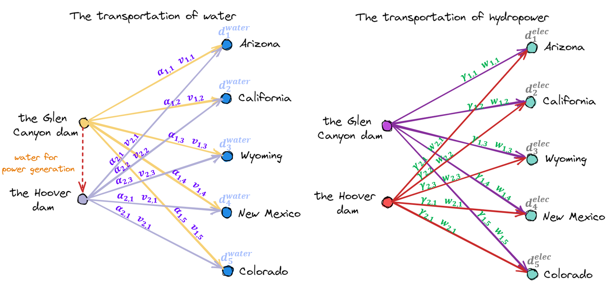

# AMETHYST / Tim

Tim 的个人数字花园。基于 [Material for MkDocs](https://squidfunk.github.io/mkdocs-material/)，发布至 **https://amethysttim.github.io/**。

暖白 / 紫晶 / 亮橙的日间主题，深紫 / 浅紫 / 珊瑚橙的夜间主题；首次跟随系统，可手动切换并记住选择。包含全文搜索、分类文档库、博客归档与 GitHub 在线编辑。

顶部统一使用「首页 / 文档库 / 随笔 / 关于」博客导航。旧版 Material 标签导航、侧边分类树与顶部仓库入口不再显示；课程、论文和竞赛记录统一通过文档库进入。文章目录只列出当前文章的章节。

## 本地启动

Windows PowerShell，在项目根目录运行：

```powershell
python -m venv .venv
.\.venv\Scripts\python.exe -m pip install -r requirements.txt
.\.venv\Scripts\python.exe -m mkdocs serve
```

打开 http://127.0.0.1:8000/。保存 Markdown 后自动刷新。

macOS / Linux 使用 `.venv/bin/python` 代替 `.\.venv\Scripts\python.exe`。

## 一篇文章，一个目录

```text
docs/
  index.md                       # 首页，由 overrides/partials/home.html 呈现
  about/index.md                 # 关于
  library/index.md               # 文档库，构建时自动生成条目
  课程笔记/大三上/操作系统/
    进程/
      index.md                   # 正文，访问地址仍是 .../进程/
      os2-1.png                  # 仅属于这篇文章的图片
      os2-2.png
  Paper/mambaIR/
    index.md
    image.png
  比赛/CUPT/COMSOL/
    index.md
    comsol1.png
  blog/
    .authors.yml                 # 作者资料
    index.md                     # 随笔列表、归档、分类
    posts/chunithm_0cost/
      chunithm_0cost.md           # 随笔保留原文件名及文章 URL
      chunithm_0cost-0.png
archive/unassigned-assets/       # 未被旧正文引用的资源，保留但不发布
config/navigation.yml            # 原有导航顺序与标题；新文档自动补入
config/migration.json            # 迁移路径、资源 SHA-256 与归档清单
overrides/                      # 首页模板与主题扩展
tools/                          # 文档管理与构建 hook
drafts/                         # 本地私有草稿（Git 忽略；自行创建）
.trash/                         # 本地回收站（Git 忽略）
```

普通正文统一用 `index.md`。博客随笔使用 `posts/文章名/文章名.md`，以兼容 Material 的博客标题与 URL 生成规则。图片和附件直接放在正文旁边，用 `` 或 `[附件](file.pdf)` 引用。避免使用 GitHub blob 图片地址或集中式 `docs/images/`。

原有文章、图片、附件、代码和 Git 历史均来自原仓库。根目录的个人研究草稿不属于网站内容，本次迁移不会发布这些文件。

## 增删查改

以下例子使用虚拟环境中的 Python；如果已激活虚拟环境，可简写为 `python`。

```powershell
# 新建笔记：自动生成正文、元信息，自动进入导航和文档库
.\.venv\Scripts\python.exe tools/content.py new --section notes --path "大三上/操作系统/虚拟内存" --title "虚拟内存" --tag "操作系统"

# 新建论文记录 / 竞赛手记
.\.venv\Scripts\python.exe tools/content.py new --section papers --path "new-paper" --title "论文阅读记录"
.\.venv\Scripts\python.exe tools/content.py new --section contests --path "数学建模/新题目" --title "一道新题目"

# 新建随笔：默认 draft: true；发表时把元信息改为 draft: false
# 也可新建时加 --publish。摘要与正文用 <!-- more --> 分隔
.\.venv\Scripts\python.exe tools/content.py new --section posts --path "hello-world" --title "新的开始" --category "生活"

# 列出所有文档；按路径或正文全文搜索，包含草稿
.\.venv\Scripts\python.exe tools/content.py list
.\.venv\Scripts\python.exe tools/content.py search "进程"

# 打开编辑器，优先使用 EDITOR，其次 VS Code，再使用系统 Markdown 关联程序
.\.venv\Scripts\python.exe tools/content.py edit "课程笔记/大三上/操作系统/进程"

# 复制图片到该文章目录，并输出可粘贴的 Markdown 引用
.\.venv\Scripts\python.exe tools/content.py attach "课程笔记/大三上/操作系统/进程" "C:\Pictures\diagram.png"

# 移动 / 重命名目录：图片一起移动，同步重写站内 Markdown 相对链接
.\.venv\Scripts\python.exe tools/content.py move "Paper/new-paper" "Paper/图像恢复/new-paper"

# 删除进本地回收站，图片一起保存；有其他文章链接到它时会拒绝并列出引用方
.\.venv\Scripts\python.exe tools/content.py delete "Paper/图像恢复/new-paper"

# 列出可恢复的条目；把列表中的 ID 传给 restore 可恢复正文和图片
.\.venv\Scripts\python.exe tools/content.py restore
.\.venv\Scripts\python.exe tools/content.py restore "列表中显示的ID"
```

`move` 的目标相对于 `docs/`，会调整站内相对链接；已发表文章若移动路径，外部书签需要另行设置重定向，建议保持路径稳定。回收站仅保存在这台电脑，已提交内容也可以通过 Git 历史找回。工具拒绝把包含多篇文章的分类目录当作一篇文章删除。

网页文档库可按分类、标题、路径或标签筛选，筛选条件可复制 URL 分享；顶部搜索检索正文。文档页右上角铅笔图标和文档库中的「编辑」会打开 GitHub 上的对应文件，适合简单修改。

## 导航与元信息

新文章无需手动登记：`tools/hooks.py` 从磁盘生成导航、文档库、首页计数和最近随笔。`config/navigation.yml` 仅保留旧文章的顺序及显示标题；不存在的条目会自动跳过，新增文件会自动补充。需要调整旧文章顺序时编辑此文件。

```yaml
---
title: 一篇笔记
date: 2026-10-19
tags:
  - 操作系统
---

# 一篇笔记


```

随笔额外需要 `date`、`authors: [dinorex]`、`categories`、`draft`。`draft: true` 的随笔不会进入网站正文、文档库和最近文章，但源文件仍会提交到公开仓库。私密内容应放在 Git 忽略的 `drafts/`，不要放进 `docs/`。

## 检查与发布

这次迁移所在的自动化环境不能写入根目录的 `.git/`，因此首次发布应在你自己的 PowerShell 中执行。先登录，再使用已准备好的发布脚本；脚本首次运行会补齐 Git 索引，保留工作区文件，然后检查、提交并推送网站源文件：

```powershell
git credential-manager github login
powershell -ExecutionPolicy Bypass -File .\publish.ps1
```

浏览器登录时选择 **AmethystTim**。不要把密码或 Token 写进项目文件。发布脚本只暂存列明的网站目录和配置，根目录中的个人研究草稿不会加入此次提交；原有 `assets/` 和 `code/` 仍保留在仓库。

日常也可手动执行：

```powershell
.\.venv\Scripts\python.exe tools/content.py check
.\.venv\Scripts\python.exe -m unittest discover -s tools -p test_content.py -v
.\.venv\Scripts\python.exe -m mkdocs build --strict

git add docs config tools overrides mkdocs.yml README.md requirements.txt .gitignore .github archive
git commit -m "Update blog"
git push origin main
```

`.github/workflows/publish.yml` 在推送 `main` 后检查内容、测试管理命令、严格构建，并发布到 `gh-pages`。PR 只验证，不发布。GitHub Pages 的来源保持 **Deploy from a branch → gh-pages → /(root)**。发布进度见 [Actions](https://github.com/AmethystTim/AmethystTim.github.io/actions)。

依赖固定为 MkDocs 1.6.1 / Material 9.7.6。原有 KaTeX 公式渲染保留，脚本和样式来自 CDN；断网时正文仍可阅读，公式渲染需要这些依赖可用。

## 迁移核对

`config/migration.json` 记录 148 篇旧文档的路径映射、282 处资源引用的迁移位置与校验值，以及 20 个未引用资源的归档位置。原始文章的 URL 结构保持不变。旧的公开图片直链随目录整理发生变化，文章正文中的引用已经同步更新。

迁移期间的原始快照及原站构建保存在本地 `.local/`，Git 会忽略它们。`tools/migrate.py` 是已执行的一次性迁移工具，不需要在日常编辑、构建或 CI 中再次运行。
