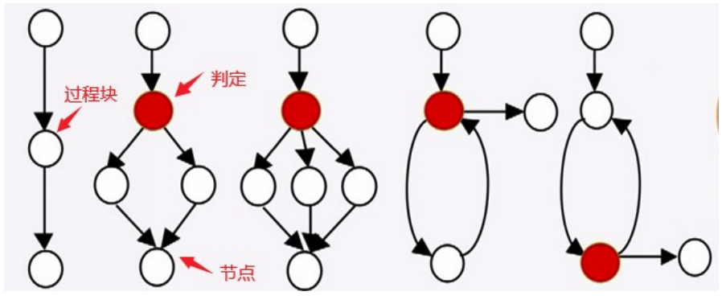

## 白盒测试

- 也称作结构测试或逻辑驱动测试，它是基于程序的源代码，已知产品的内部工作过程，主要是对程序内部结构展开测试，关注程序实现细节，检验程序中的每条通路是否都有按照预定要求正确工作

### 控制流程图

一种表示程序控制结构的图形工具，其基本元素是节点、判定节点、过程

{width=400}

> 缺陷风险等级：线性结构<两分支判断<多分支判断<循环结构

### 建立被测对象模型

### 逻辑覆盖方法

1. 语句覆盖：至少执行程序中所有语句一次（最弱👎🏻逻辑覆盖准则）
2. 判定覆盖
3. 条件覆盖
4. 判定条件覆盖
5. 条件组合覆盖
6. 路径覆盖（所有可能的情况执行一次）

## 黑盒测试

- 也称作功能测试或数据驱动测试，它着眼于程序外部结构，在完全不考虑程序的内部逻辑结构和内部特性的情况下，测试者在程序接口进行测试，它只检查程序功能是否按照需求规格说明书的规定正常使用，程序是否能适当的接收输入数据而产生正确的输出信息

### 等价类划分

#### 等价类

输入域的一个子集，在该子集中，各个输入数据对揭示程序中错误是等效的

#### 等价类测试

将无穷多的数据缩减到有限个等价区域中，通过测试等价区域完成穷尽测试

- 特点：
    - 分而不交
    - 合而不变
    - 类内等价

#### 划分原则

1. 如果输入条件规定了一个取值范围或取值个数，则可确定一个有效等价类和两个无效等价类。（如：数量从1到999，无效等价类有：大于999的数量，小于1的数量）
2. 如果输入条件规定了一个输入值的集合（假定n个），而且软件要对每个输入值进行不同处理，则可确定n个有效等价类和一个无效等价类。
3. 如果存在输入条件规定了“必须是”的情况，则可确定一个有效等价类和一个无效等价类。（如：标识符第一个字符必须是字母）
4. 如果输入的是布尔表达式，则可确定一个有效等价类和一个无效等价类。

### 边界值分析

### 场景法